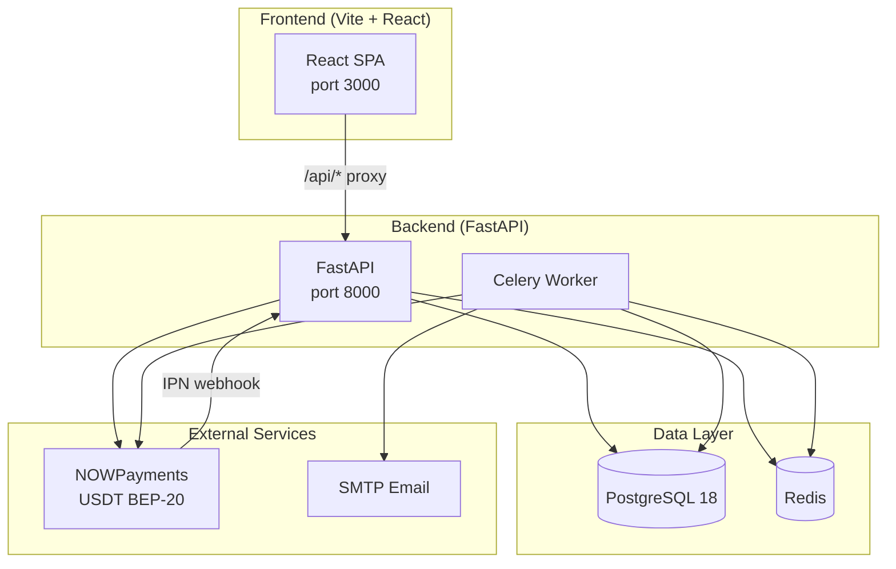
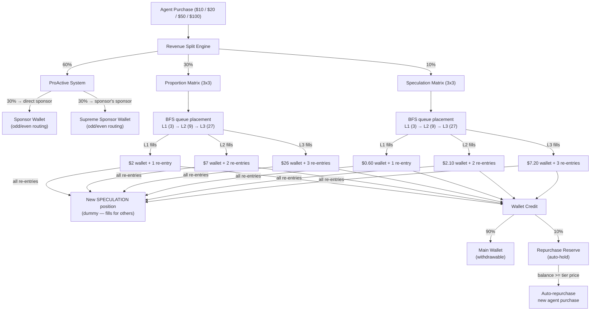
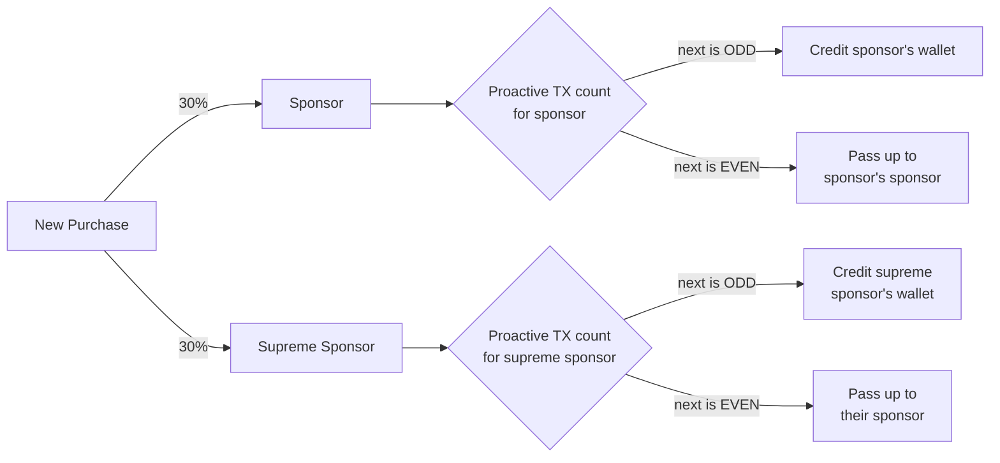
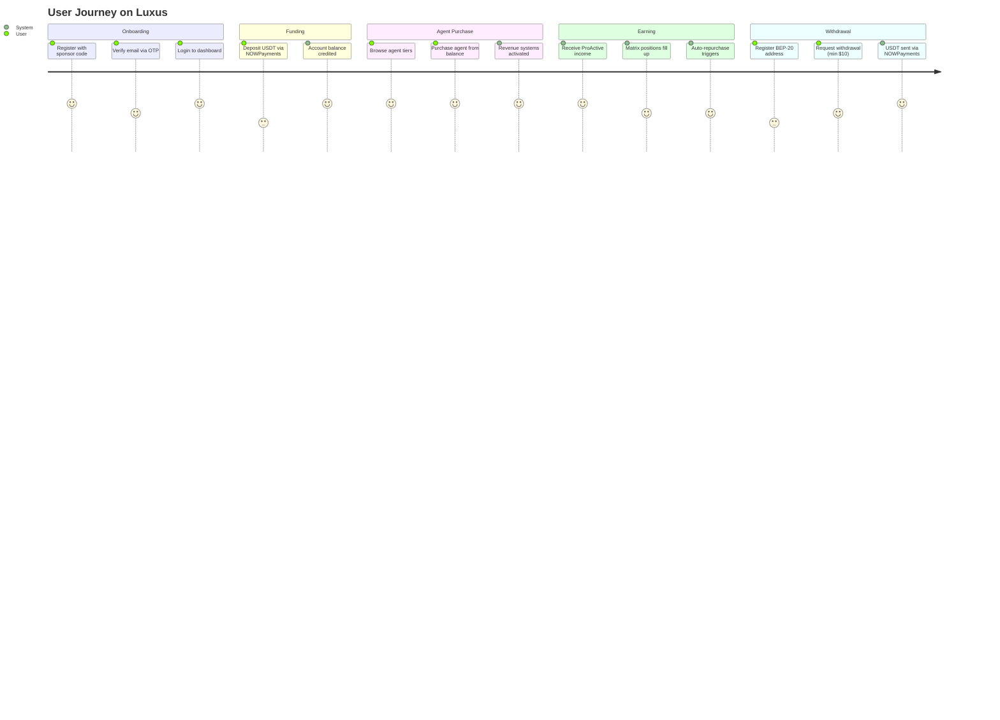
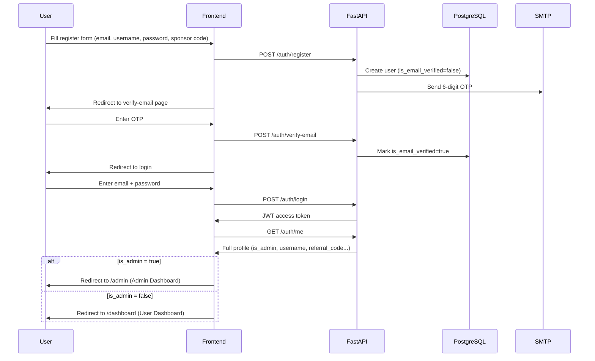
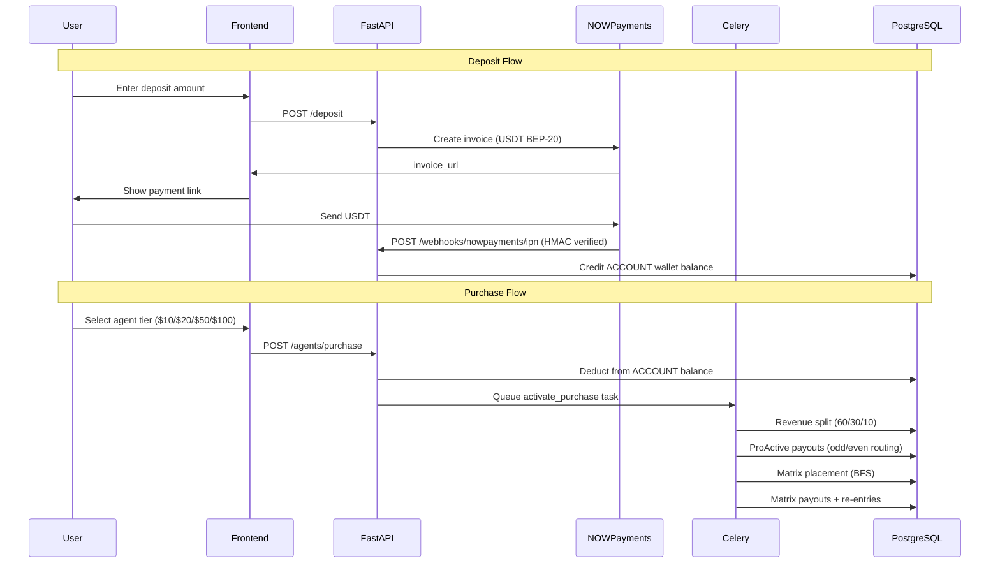
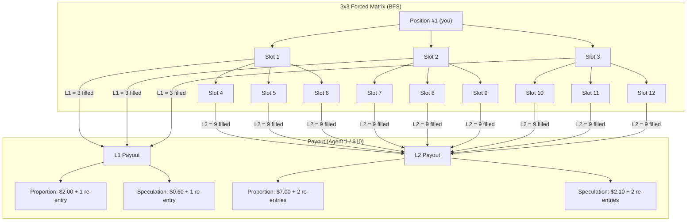
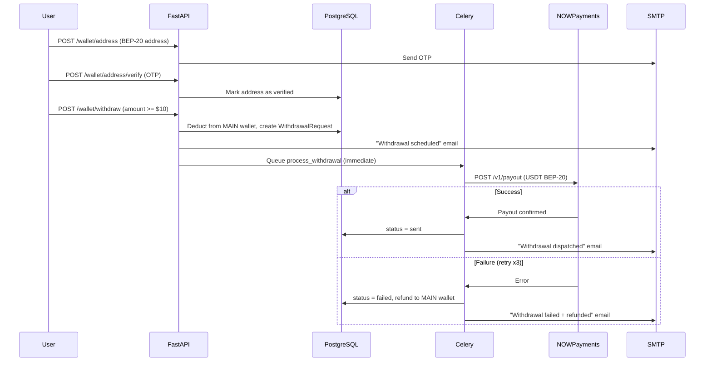

# Luxus — AI Agent Revenue Sharing Platform

A multi-tier passive income platform where users purchase AI agent tiers and earn revenue through three parallel systems: ProActive income, Proportion matrix, and Speculation matrix.

---

## Table of Contents

- [Architecture](#architecture)
- [Revenue Flow](#revenue-flow)
- [User Journey](#user-journey)
- [Auth Flow](#auth-flow)
- [Deposit & Purchase Flow](#deposit--purchase-flow)
- [Matrix System](#matrix-system)
- [Withdrawal Flow](#withdrawal-flow)
- [Tech Stack](#tech-stack)
- [Setup & Installation](#setup--installation)
- [Running the Project](#running-the-project)
- [Admin Setup](#admin-setup)
- [Environment Variables](#environment-variables)

---

## Architecture



---

## Revenue Flow

Every confirmed agent purchase triggers a **60/30/10 split** that runs three parallel income systems.



### ProActive Odd/Even Rule



---

## User Journey



---

## Auth Flow



---

## Deposit & Purchase Flow



---

## Matrix System



---

## Withdrawal Flow



---

## Tech Stack

| Layer | Technology |
|-------|-----------|
| Frontend | Vite + React 18 + Tailwind CSS |
| Backend | FastAPI (Python 3.11+) |
| Database | PostgreSQL 18 |
| Task Queue | Celery + Redis |
| Auth | JWT — python-jose + passlib/bcrypt 4.0.1 |
| Payments | NOWPayments (USDT on BEP-20) |
| Email | SMTP (configurable — Gmail, Mailer91, etc.) |

---

## Setup & Installation

### Prerequisites

- Python 3.11+ with conda env `luxus`
- PostgreSQL 18 running on localhost:5432
- Redis running on localhost:6379
- Node.js 18+ (for frontend)

### 1. Clone & configure environment

```bash
cp .env.example .env
# Edit .env — fill in NOWPAYMENTS keys, SMTP credentials, ADMIN_* fields
```

### 2. Install backend dependencies

```bash
conda activate luxus
pip install -r requirements.txt
```

### 3. Create database tables

```bash
cd backend
python create_tables.py
```

### 4. Run all migrations in order

```bash
python migrate_v2.py   # enum values + deposits table
python migrate_v3.py   # sponsor_milestone_income enum
python migrate_v4.py   # is_admin column
python migrate_v5.py   # dummy re-entries, transfer verifications, wallet addresses
python migrate_v6.py   # fix enum case mismatch (ACCOUNT, DEPOSIT, etc.)
```

### 5. Seed the admin user

```bash
python seed_admin.py
```

Reads `ADMIN_EMAIL`, `ADMIN_USERNAME`, `ADMIN_PASSWORD`, `ADMIN_REFERRAL_CODE` from `.env`. Safe to re-run.

### 6. Install frontend dependencies

```bash
cd ../frontend
npm install
```

---

## Running the Project

Open **4 terminals**:

```bash
# Terminal 1 — Backend API
conda activate luxus
cd backend
uvicorn app.main:app --reload
# → http://localhost:8000
# → Swagger docs: http://localhost:8000/docs

# Terminal 2 — Celery worker (handles async revenue + withdrawals)
conda activate luxus
cd backend
celery -A app.workers.celery_app worker --loglevel=info

# Terminal 3 — Redis (if not running as a service)
redis-server

# Terminal 4 — Frontend
cd frontend
npm run dev
# → http://localhost:3000
```

---

## Admin Setup

The admin cannot self-register. Create via the seed script:

```bash
# Set credentials in .env first:
ADMIN_EMAIL=admin@yourdomain.com
ADMIN_USERNAME=admin
ADMIN_PASSWORD=StrongPassword@123
ADMIN_REFERRAL_CODE=ADMIN001

cd backend
python seed_admin.py
```

Login at **http://localhost:3000** with the admin credentials — the system automatically routes admin users to the **Admin Dashboard** (`/admin`).

### Admin capabilities

- Platform-wide stats (users, transactions, withdrawals)
- Freeze / unfreeze user accounts
- Credit or debit any user's wallet directly
- View all withdrawals and transaction history
- Access their own user account pages (wallet, matrix, etc.) from admin sidebar

---

## Environment Variables

| Variable | Description |
|----------|-------------|
| `DATABASE_URL` | PostgreSQL connection string |
| `REDIS_URL` | Redis connection string |
| `SECRET_KEY` | JWT signing secret (use a long random string in production) |
| `APP_ENV` | `development` (sandbox) or `production` (live NOWPayments) |
| `NOWPAYMENTS_API_KEY` | NOWPayments API key |
| `NOWPAYMENTS_IPN_SECRET` | NOWPayments IPN secret for HMAC verification |
| `NOWPAYMENTS_CALLBACK_BASE` | Public URL of backend for IPN callbacks (use ngrok locally) |
| `FRONTEND_URL` | Frontend URL for payment redirect links |
| `SMTP_SERVER` | SMTP host |
| `SMTP_PORT` | SMTP port (usually 587) |
| `SMTP_USERNAME` | SMTP login username |
| `SMTP_PASSWORD` | SMTP password / app password |
| `SENDER_EMAIL` | From address for outgoing emails |
| `ADMIN_EMAIL` | Admin account email (used by seed_admin.py) |
| `ADMIN_USERNAME` | Admin account username |
| `ADMIN_PASSWORD` | Admin account password |
| `ADMIN_REFERRAL_CODE` | Admin referral code (used as sponsor for first users) |

---

## Agent Tier Pricing & Payouts

| Tier | Price | ProActive (60%) | Proportion L3 | Speculation L3 |
|------|-------|-----------------|---------------|----------------|
| Agent 1 | $10 | $6.00 split between sponsor chain | $26.00 | $7.20 |
| Agent 2 | $20 | $12.00 split | $52.00 | $14.40 |
| Agent 3 | $50 | $30.00 split | $130.00 | $36.00 |
| Agent 4 | $100 | $60.00 split | $260.00 | $72.00 |

All payouts: **90% to main wallet** (withdrawable) + **10% to repurchase reserve** (auto-held).
When repurchase reserve reaches the tier price, a new agent is automatically purchased.
